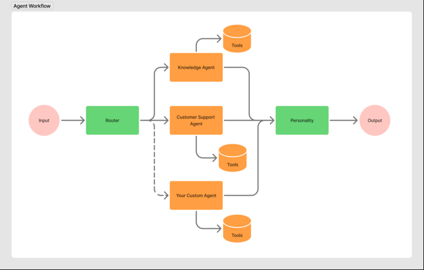

# Getnet Multi-Agent Support

A multi-agent support service for Getnet merchants, built for the challenge in
[docs/challenge.md](docs/challenge.md). A merchant sends a message in English or Portuguese to
`POST /chat`. A Router plans the work, a bounded supervisor loop runs specialized agents
(Knowledge with RAG over a snapshot of the Getnet sites or Google Search grounding, Customer
Support with tools over the merchant's own simulated data, Human Escalation with an operator
queue), a critic revises the plan when needed, and a Personality step writes the final answer in
the Getnet voice, checked by code. The service runs with FastAPI, Gemini models through the
`google-genai` SDK, Chroma as the vector store and SQLite for state. Requirements and design live
in [specs/001-getnet-multi-agent-support/](specs/001-getnet-multi-agent-support/) and the project
rules in [.specify/memory/constitution.md](.specify/memory/constitution.md).



## Quick start

Requirements: Docker with compose. Create `.env` and fill the three secrets:

```bash
cp .env.example .env
# edit .env:
#   GEMINI_API_KEY=<your key>
#   JWT_SECRET=<output of: openssl rand -hex 32>
#   PSEUDONYM_KEY=<output of: openssl rand -hex 32>
```

Build and start (the API becomes ready once the knowledge base is ingested):

```bash
docker compose up --build --wait
curl -s localhost:8000/health/ready
```

Issue a token with the CLI (no endpoint issues tokens) and send the challenge payload:

```bash
TOKEN=$(docker compose exec -T api getnet-multi-agent token --sub cliente1988 --role merchant)

curl -s -X POST localhost:8000/chat \
  -H "Authorization: Bearer $TOKEN" \
  -H "Content-Type: application/json" \
  -d '{"message": "What'\''s the difference between the Get Clássica and the Get Smart?", "user_id": "cliente1988"}'
```

Without compose:

```bash
docker build -t getnet-multi-agent .
docker run --env-file .env -p 8000:8000 -v gma-state:/app/data/state getnet-multi-agent
# token: docker exec <container> getnet-multi-agent token --sub cliente1988 --role merchant
```

Stub mode runs the whole pipeline without a Gemini key, using a deterministic keyword planner,
canned outputs and hash embeddings (`core/stub.py`). It is what CI uses:

```bash
LLM_MODE=stub docker compose up --build --wait
```

## Configuration

All settings come from `.env`; every variable is listed in [.env.example](.env.example).

| Group | Variable | Default | Meaning |
|---|---|---|---|
| Models and thinking levels | `GEMINI_API_KEY` | empty | Gemini API key (secret) |
| | `GEMINI_MODEL` / `GEMINI_MODEL_THINKING` | `gemini-3.8-flash` / `low` | answering agents, synthesis, Personality |
| | `GEMINI_ROUTER_MODEL` / `GEMINI_ROUTER_THINKING` | `gemini-3.5-flash-lite` / `minimal` | Router, critic completeness check, rolling summary |
| | `GEMINI_EMBEDDING_MODEL` | `gemini-embedding-2` | document and query embeddings (768 dimensions) |
| | `GEMINI_JUDGE_MODEL` / `GEMINI_JUDGE_THINKING` | `gemini-3.8-flash` / `high` | eval judge |
| | `LLM_MODE` | `live` | `live` or `stub` |
| Prices (USD) | `PRICE_FLASH_INPUT_PER_M` / `PRICE_FLASH_OUTPUT_PER_M` | `0.75` / `3.75` | per million tokens, flash and judge models |
| | `PRICE_LITE_INPUT_PER_M` / `PRICE_LITE_OUTPUT_PER_M` | `0.30` / `2.50` | per million tokens, router model |
| | `PRICE_EMBEDDING_PER_M` | `0.20` | per million embedding tokens |
| | `PRICE_SEARCH_PER_1K` | `14` | per thousand Google Search grounding queries |
| Identity | `JWT_SECRET` | empty | HS256 signing key (secret) |
| | `JWT_ISSUER` / `JWT_AUDIENCE` | `getnet-multi-agent` / `getnet-multi-agent-api` | required `iss` and `aud` claims |
| | `PSEUDONYM_KEY` | empty | HMAC key for user pseudonyms in logs and storage (secret) |
| Limits | `MAX_MESSAGE_CHARS` | `2000` | message length limit |
| | `RAG_TOP_K` | `6` | chunks per retrieval |
| | `RAG_MAX_PAGES` | `80` | page limit of the refresh crawl |
| | `RAG_MIN_SIMILARITY` | `0.62` | vector similarity threshold (1 minus cosine distance) |
| | `MAX_TOOL_ITERATIONS` | `3` | function-calling rounds per support step |
| | `MAX_SUPERVISOR_ITERATIONS` | `3` | supervisor loop iterations |
| | `REQUEST_TOKEN_BUDGET` | `30000` | LLM tokens per request |

Constants in code: LLM timeout 30 s with one retry on 429 or 5xx, last 6 turns given to the
Router, rolling summary refreshed after 6 new turns, token expiry 12 h by default.

## Run and test

Requirements: [uv](https://docs.astral.sh/uv/) and Python 3.12. No API key is needed.

```bash
uv sync --frozen
uv run pytest
uv run ruff check .
docker run --rm -v "$PWD/ops/prometheus:/p" --entrypoint promtool \
  prom/prometheus:v3.16.0@sha256:e04987641b57704f408e31f6373ba4138ecf27cb4a165d24aabb6c38fddd0f06 \
  test rules /p/alerts.test.yml
```

CLI (`getnet-multi-agent`, also inside the container):

| Command | Behavior |
|---|---|
| `token --sub <id> --role merchant\|operator [--hours 12]` | prints a JWT signed with `JWT_SECRET` |
| `ingest [--rebuild]` | builds the vector collection from `data/crawl_cache/`, offline |
| `refresh` | crawls the Getnet sites and rewrites `data/crawl_cache/`; the only networked crawl |

## Architecture

Module map (`src/getnet_multi_agent/`):

| Module | Content |
|---|---|
| `api/` | FastAPI app, `/chat`, `/conversations`, `/operator`, `/health`, `/metrics`, JSON errors, HTTP metrics middleware, startup ingestion |
| `supervisor.py` | bounded supervisor loop, escalation, Personality, final checks |
| `agents/` | `planner` (Router), `knowledge`, `support` and `tools`, `escalation`, `critic`, `synthesis`, `personality`, `summary`; one prompt module per agent in `agents/prompts/` |
| `rag/` | `crawler` (refresh), `extract`, `chunk`, `ingest`, `store` (Chroma), `glossary`, `retriever` |
| `security/` | `auth` (JWT), `guardrails` (input checks before any LLM call), `dlp` (Luhn, CPF, other merchants, masking), `pseudonym` (HMAC) |
| `state/` | SQLite (WAL): `conversations`, `checkpoints`, `tickets`, `audit` |
| `core/` | `llm` (the only module that imports `google.genai`), `stub`, `settings`, `context` (request id and token budget), `logging`, `metrics` |
| `format/` | language detection, money and date formatting, answer-quality fixes |
| `contracts.py` | typed models: Plan, Step, Observation, Trace, Ticket, ChatRequest, ChatResponse |
| `cli.py` | `token`, `ingest`, `refresh` |

Agents:

- **Router / planner** (lite model, typed output): ordered steps (`support`, `knowledge` with
  source `rag` or `web`), language `en` or `pt`, a standalone rewrite of the message using the
  rolling summary and the last 6 turns, and either a refusal reason (`out_of_scope`, `unsafe`,
  `other_merchant`, `prompt_injection`) or an escalation request.
- **Knowledge** (`knowledge:rag`): grounded answer from retrieved chunks of the Getnet snapshot,
  or `NO_ANSWER`. **Knowledge** (`knowledge:web`): Google Search grounding for general facts
  (weather, exchange rate, news).
- **Customer Support** (`support`): function-calling loop with `get_receivables` (settlement
  dates and amounts, validated period filter) and `get_terminal_status` (connectivity, last
  errors with decline reasons, suggested actions), over `data/merchants.json`.
- **Human Escalation** (custom agent): stores a run checkpoint, opens a ticket in the operator
  queue and tells the merchant what happens next.
- **Critic**: deterministic rules, then a lite-model completeness check.
- **Synthesis**: merges answers from more than one step into one draft.
- **Personality**: rewrites the draft in the planned language and brand voice, checked by code.

Why plain Python with direct function calls: the constitution forbids agent frameworks. The loop
is about 250 lines in `supervisor.py`, every revision is visible in the trace, each agent is a
function that takes typed inputs and returns an `AgentResult`, and tests replace the LLM with a
fake at one interface (`contracts.LLM`).

## Supervisor loop

`supervisor.Supervisor.run`:

1. **Plan.** The Router returns a typed plan. A refusal ends the run with a fixed refusal text;
   an escalation request goes straight to Human Escalation. A plan with no steps gets one
   `knowledge:rag` step.
2. **Steps and observations.** Each pending step runs and records an observation: status
   (`answered`, `not_found`, `ungrounded`, `failed`), evidence (chunk URL and score, tool result,
   web source), facts, model, latency, tokens and cost. A step that raises is recorded as
   `failed` and only that part escalates.
3. **Critic rules (code).**
   - A support observation with a terminal offline or a connectivity error adds a `knowledge:rag`
     step for the site's troubleshooting steps (communication test).
   - A transaction decline is answered by Support alone: pending knowledge steps about the decline
     are dropped.
   - An ungrounded knowledge step is retried once with a query rewritten with glossary aliases; if
     still ungrounded, that part escalates and answered parts are kept (partial escalation).
4. **Lite completeness check.** When nothing is pending, the lite model checks whether every part
   of the standalone message is answered; an unanswered part adds a `knowledge:rag` step.
5. **Stop.** The loop ends when complete, at `MAX_SUPERVISOR_ITERATIONS`, or when
   `REQUEST_TOKEN_BUDGET` is spent (`BudgetExceeded` escalates with reason `budget_exceeded`;
   LLM unavailability after one retry escalates with `llm_failure`).
6. **Synthesis.** Answered parts are merged into one draft.
7. **Personality.** The draft is rewritten in brand voice. Code checks that every number and URL
   in the output appears in the draft and that the ticket id is kept; on violation or failure the
   draft is returned and the violation is counted.
8. **Code finishing.** The escalation note with the ticket id is appended, answer-quality fixes
   run (em and en dashes replaced, markdown bold removed, ISO dates and language mismatch
   flagged), the final DLP check masks any card number, CPF or other merchant id, sources are
   attached as a response field, and when a source is on `www.getnet.net` one sentence says the
   global site may differ for Brazil.

Every revision (`initial`, `add`, `retry`, `drop`) and its reason goes to `trace.plan_revisions`;
completeness verdicts go to `trace.critic_notes`.

## Message workflow

One `POST /chat` request end to end (`api/chat.py`):

1. **Auth.** Bearer JWT verified (HS256, `iss`, `aud`, `exp`, `sub`, role `merchant`); 401 when
   missing or invalid, 403 when `user_id` differs from `sub`.
2. **Validation.** Message over `MAX_MESSAGE_CHARS` returns 422 JSON; nothing is stored.
3. **Conversation.** With `conversation_id`, ownership is checked by pseudonym (404 for another
   principal); without it a new conversation starts.
4. **Request context.** A `request_id` and a per-request token budget are created; the message is
   masked for storage and logs.
5. **Guardrails before any LLM.** Luhn-valid card numbers and valid CPFs (`sensitive_data`),
   another merchant's id (`other_merchant`) and known injection patterns in English and Portuguese
   (`prompt_injection`) are refused by code in the message language, with no model call.
6. **Supervisor.** The Router gets the rolling summary and the last 6 turns; the loop above runs.
7. **Persistence.** User and assistant turns are stored masked; the rolling summary is refreshed
   by the lite model after 6 new turns (a summary failure does not fail the request).
8. **Metrics and logs.** Request counter by route and status, latency histogram, one
   `chat_response` log line with tokens and cost.
9. **Response.** `answer`, `status` (`answered`, `awaiting_human`, `refused`), `refusal_reason`,
   `route` (`support`, `knowledge:rag`, `knowledge:web` joined by `>` in execution order, or
   `refusal`, `escalation`), `sources`, `ticket_id`, `conversation_id`, `request_id` and `trace`
   (plan revisions, critic notes, observations with evidence excerpts of about 300 characters,
   per-call model, latency, tokens and cost, request totals, quality violations).

## RAG pipeline

1. **Ingestion** (`rag/ingest.py`, `rag/extract.py`, `rag/chunk.py`). Offline, from the committed
   `data/crawl_cache/` only (`<sha256(normalized url)>.json` metadata plus `.html`). Keeps status
   200 `text/html` entries from `site.getnet.com.br` and `www.getnet.net/en`, deduplicates by
   final URL and by visible-text hash. Extraction drops script, style, nav, header, footer and
   text repeated in 30% or more of the pages (boilerplate), and keeps tables, product cards and
   FAQ question and answer pairs. Chunking splits by heading and by FAQ question; each chunk keeps
   its page URL, title and site (`br` or `global`). Ingestion runs in the background at startup
   when the collection is empty; a failure leaves the service up with `/health/ready` at 503.
2. **Storage** (`rag/store.py`). Chroma persistent collection `getnet_kb` in cosine space on the
   state volume, with 768-dimension `gemini-embedding-2` vectors embedded as
   `RETRIEVAL_DOCUMENT` (queries use `RETRIEVAL_QUERY`).
3. **Retrieval** (`rag/retriever.py`). Hybrid: vector top-k with similarity = 1 minus distance
   above `RAG_MIN_SIMILARITY`, plus lexical matching where each alias group of the glossary
   (`rag/glossary.py`: Get Clássica = Get Classic, Link de Pagamento = Payment Link, antecipação =
   receivables advance, conta bancária = domicílio bancário, connectivity terms and others) counts
   as one term. Score = 0.6 vector + 0.4 lexical + 0.1 boost for chunks stating a rule
   ("precisa", "até", "must", "required"). A message naming two or more products runs one
   sub-query per product with its aliases and merges the results, so a comparison retrieves pages
   for both. Repeated FAQ texts are removed. `GET /operator/retrieval?q=&mode=hybrid|vector`
   exposes the ranking for evaluation.
4. **Generation** (`agents/knowledge.py`). The flash model answers only from chunks delimited as
   `<data>`, or returns `NO_ANSWER` (ungrounded, then retry or escalation). Citations are the
   pages whose text shares the most words and numbers with the answer (up to three). Global-site
   content gets the Brazil caveat added by code.

Refreshing the snapshot is an explicit command and the only networked crawl:
`docker compose exec api getnet-multi-agent refresh` (one level deep from each start page plus
the `/duvidas` topic pages, same host, sequential, 2 s between requests, a host stops at its first
403 or 429, at most `RAG_MAX_PAGES` pages), then `getnet-multi-agent ingest --rebuild`.

## Tools and how LLM tools were used

- **Function calling** (`agents/support.py`, `agents/tools.py`). The support agent declares
  `get_receivables` and `get_terminal_status`. The loop runs up to `MAX_TOOL_ITERATIONS` rounds;
  the whole model `Content` of each round is appended back to the conversation, so Gemini thought
  signatures survive across tool turns. The merchant id comes from the authenticated principal,
  never from model arguments. Tools return raw values and typed not-found results; code formats
  amounts and dates in the answer language (pt `R$ 1.250,00`, `25/11/2026`; en `R$ 1,250.00`,
  `25 Nov 2026`) before the model sees them, inside `<data>` delimiters.
- **Google Search grounding** (`agents/knowledge.py`, `core/llm.py`). Web steps call the model
  with the `google_search` tool in a separate request; the wrapper refuses a request mixing search
  with function calling or a response schema. Sources come from grounding metadata, and Search
  queries are priced with `PRICE_SEARCH_PER_1K`.
- **Structured output.** Router plan and critic verdict use typed response schemas.
- **One wrapper** (`core/llm.py`) for every call: model routing by role, 30 s timeout, one retry
  on 429 or 5xx, token budget check, token and USD cost accounting per call, trace and metrics.

## Identity, memory and human in the loop

Identity: HS256 JWTs with `iss`, `aud`, `exp`, `sub` and `role` (`merchant` or `operator`),
issued only by the CLI. Logs and storage use an HMAC pseudonym of the user id; raw ids do not
reach prompts.

Follow-up in the same conversation and reading it back:

```bash
TOKEN=$(docker compose exec -T api getnet-multi-agent token --sub cliente1988 --role merchant)

CID=$(curl -s -X POST localhost:8000/chat -H "Authorization: Bearer $TOKEN" \
  -H "Content-Type: application/json" \
  -d '{"message": "What is the Get Smart?", "user_id": "cliente1988"}' | jq -r .conversation_id)

curl -s -X POST localhost:8000/chat -H "Authorization: Bearer $TOKEN" \
  -H "Content-Type: application/json" \
  -d "{\"message\": \"and how much is it?\", \"user_id\": \"cliente1988\", \"conversation_id\": \"$CID\"}"

curl -s localhost:8000/conversations/$CID -H "Authorization: Bearer $TOKEN"
```

Conversations, turns, rolling summaries, checkpoints, tickets and audit entries live in SQLite on
the `state` volume and survive restarts. Another principal's conversation id returns 404.

Escalation and the operator queue:

```bash
TICKET=$(curl -s -X POST localhost:8000/chat -H "Authorization: Bearer $TOKEN" \
  -H "Content-Type: application/json" \
  -d "{\"message\": \"I want to talk to a person\", \"user_id\": \"cliente1988\", \"conversation_id\": \"$CID\"}" \
  | jq -r .ticket_id)      # status awaiting_human, route escalation

OP=$(docker compose exec -T api getnet-multi-agent token --sub operador1 --role operator)

curl -s "localhost:8000/operator/tickets?status=open" -H "Authorization: Bearer $OP"
curl -s -X POST localhost:8000/operator/tickets/$TICKET/claim -H "Authorization: Bearer $OP"
curl -s -X POST localhost:8000/operator/tickets/$TICKET/claim -H "Authorization: Bearer $OP"   # 409
curl -s -X POST localhost:8000/operator/tickets/$TICKET/resolve -H "Authorization: Bearer $OP" \
  -H "Content-Type: application/json" \
  -d '{"action": "edit", "text": "Your settlement is scheduled for the next business day."}'

curl -s localhost:8000/conversations/$CID -H "Authorization: Bearer $TOKEN"   # operator turn
```

Escalation triggers: explicit request for a person, missing grounding after the retry, tool
failure, LLM failure, exceeded budget. Claim is one guarded `UPDATE` so exactly one operator wins;
the second gets 409. Resolve accepts `approve` (sends the ticket draft; 422 when there is none),
`edit` (sends the operator text) or `reject` (polite decline using the operator text as reason),
only by the claiming operator (else 409). The answer passes through Personality and lands in the
same conversation as an `operator` turn. Ticket creation, claim and resolution each write an
audit entry (operator pseudonym, action, ticket, time).

## Testing strategy

- **Unit tests** (`tests/unit/`): each agent, the supervisor, critic rules, guardrails, DLP,
  auth, RAG extraction, chunking, ingestion and retrieval, formatting, tickets, settings, alerts,
  dashboard, workflows and container files. The LLM is replaced by `FakeLLM`
  (`tests/conftest.py`), a scripted stand-in keyed by call purpose with deterministic hash
  embeddings.
- **Integration tests** (`tests/integration/`): the real FastAPI app through `TestClient` with a
  temporary database, the LLM stubbed at the wrapper and a fake retriever; covers auth codes,
  refusals with no LLM call, conversation ownership and follow-ups, the offline-terminal replan,
  escalation with claim and resolve, LLM failure escalating with valid JSON, JSON validation
  errors, retrieval, health and metrics.
- **Traceability**: every functional requirement has a test with its ID in the name
  (`test_fr029_...`).
- **CI smoke**: the container starts in stub mode and a real `/chat` request must return JSON with
  `status` and `request_id`.

## Evaluation

The eval scripts in `evals/` call the live API in the container (contract:
[cli-and-evals.md](specs/001-getnet-multi-agent-support/contracts/cli-and-evals.md)).

```bash
docker compose up --build --wait
uv run python evals/run.py --dataset evals/dataset.jsonl     # writes evals/report.md
uv run python evals/retrieval.py                              # writes evals/retrieval_report.md
uv run python evals/calibrate.py export                       # labeling sheet evals/labels.csv
uv run python evals/calibrate.py score                        # judge agreement with human labels
```

- **Dataset** (`evals/dataset.jsonl`, one JSONL format for every set): the ten official
  scenarios, Portuguese cases in merchant wording, the compound case, adversarial cases (prompt
  injection, tool-result injection, card number, CPF, another merchant's data, out of scope,
  unsafe), authorization, multi-turn memory, and approve, edit and reject resolutions.
- **Checks by code**: route, status, `must_contain`, expected source URL and the answer-quality
  rules (no dashes, no bold, no ISO dates, language).
- **LLM judge**: typed verdict with scores 1 to 5 for correctness, groundedness, relevance,
  helpfulness and clarity for a merchant, plus a pass or fail with rationale per `must_mention` and
  `must_not` item, judged against evidence (RAG excerpts, `[tool]` results, `[web]` sources).
  Each judgment runs in its own request context and budget; cases where judge and code disagree
  are listed for human adjudication.
- **Thresholds** (exit 1 when missed): routing accuracy at least 90%, deterministic quality checks
  100%, correct refusals 100%, citation rate at least 95%, source match at least 80%,
  `must_mention` pass at least 90%, each judge criterion average at least 4.0. The report includes
  results by language, p50 and p95 latency, cost per request and the five lowest-clarity answers.
- **Calibration**: `calibrate.py` exports a sheet for human labels and reports agreement per
  criterion (target at least 80% within one point).
- **Retrieval metrics**: Hit@k, Recall@k, MRR, nDCG@k, context precision and recall, split by
  language, hybrid compared with vector-only, from `evals/retrieval.jsonl` through
  `/operator/retrieval`.
- **Held-out set**: `--heldout PATH` verifies the file's SHA-256 against `evals/heldout.sha256`
  before running. The held-out file stays outside the repository.

## Observability

- **Logs**: JSON lines on stdout with `ts`, `level`, `event`, `request_id` and `app_rev` (the
  image revision), with card numbers and CPFs masked and user ids pseudonymized.
- **Metrics** at `/metrics`: `getnet_requests_total{route,status}`,
  `getnet_http_responses_total{path,code}`, `getnet_request_latency_seconds`,
  `getnet_llm_tokens_total{model,kind}`, `getnet_llm_cost_usd_total{model}`,
  `getnet_replans_total`, `getnet_refusals_total{reason}`, `getnet_escalations_total{reason}`,
  `getnet_quality_violations_total{rule}`, `getnet_tickets_open`,
  `getnet_ticket_oldest_age_seconds`.
- **Alerts** (`ops/prometheus/alerts.yml`, unit-tested in `alerts.test.yml` with `promtool`): 5xx
  rate above 5%, p95 latency above 20 s, LLM cost above US$ 1 per hour, oldest open ticket older
  than 30 minutes.
- **Dashboard**: Prometheus and Grafana with a provisioned dashboard (`ops/grafana/`):

```bash
docker compose --profile observability up -d
# Grafana http://localhost:3000 (anonymous viewer), Prometheus http://localhost:9090
```

## CI

- [.github/workflows/ci.yml](.github/workflows/ci.yml), on every push: `uv sync --frozen`, ruff,
  pytest, `promtool check rules` and `promtool test rules`, then `docker compose up --build
  --wait` in stub mode with generated secrets and a `/chat` smoke test.
- [.github/workflows/live-eval.yml](.github/workflows/live-eval.yml), on tags `sessao-*`: starts
  the stack with the `GEMINI_API_KEY` secret, runs the answer eval with failure reruns and the
  retrieval eval, and uploads both reports.

## Security

Identity is enforced by code on every route except health and metrics; tools read only the
authenticated merchant's data; card numbers, CPFs, other merchants' ids and known injection
patterns are refused before any LLM call; retrieved text and tool results are delimited as
untrusted data; the final answer passes a DLP check; logs and stored turns are masked; secrets
come only from `.env`; the image runs as a non-root user with the base image pinned by digest.
Threats, controls and residual risks: [docs/threat-model.md](docs/threat-model.md).

## Known limits

- **Single node.** State is SQLite and the vector store is embedded Chroma, both on one volume.
  Scaling path: Postgres for conversations, tickets and checkpoints, a managed vector store, and
  stateless API replicas behind a load balancer.
- **Demo identity provider.** HS256 tokens issued by the CLI with a shared secret. Production
  would use an external IdP with RS256 and JWKS.
- **Judge bias.** The judge model is from the same family as the answering agents; calibration
  against human labels mitigates but does not remove this.
- **Snapshot knowledge base.** Answers come from the crawl in `data/crawl_cache/` (November
  2026) and go stale until `refresh` runs.
- **Google Search grounding** requires a paid-tier Gemini key.
- **Simulated merchant data** in `data/merchants.json`, with dates relative to the current day.

### Not built in this session

Declared cuts from the 60-minute session (optional tasks marked CUT-FIRST in
`specs/001-getnet-multi-agent-support/tasks.md`):

- Rate limiting per principal on `/chat`: not built; the per-request token budget, the message
  length limit and the iteration limits bound cost per request, not request volume.
- Operator webhook on new tickets: not built; operators poll `GET /operator/tickets`, and the
  `GetnetTicketWaiting` alert fires when a ticket waits over 30 minutes.
- MCP server exposing the support tools: not built.
- Container image scanning in CI: not built.
- Approval-gated receivables advance action: not built; the assistant explains advance but never
  executes it.
- Final-answer DLP checks card numbers, CPFs and other merchant ids; it does not scan for secrets.
- Indirect injection through retrieved pages is covered by an integration test with a planted
  chunk, not by a live eval case, to keep the committed snapshot unpolluted.
- Judge calibration: `evals/calibrate.py export` produces the labeling sheet; human labels were
  not collected during the session, so judge agreement is not yet measured.

Live answer review of the official scenarios: [docs/answer-review.md](docs/answer-review.md).
